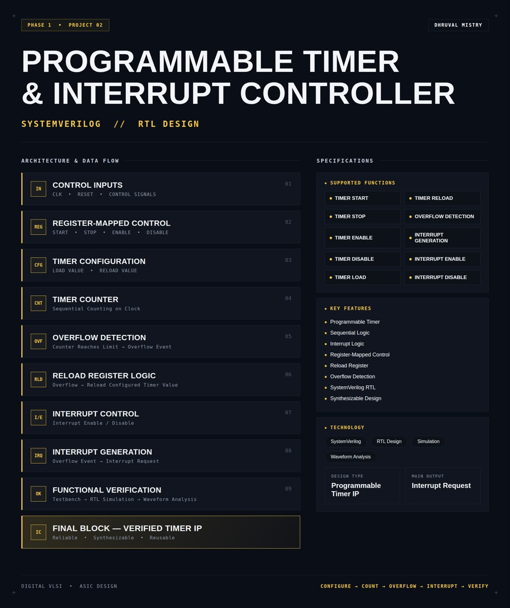
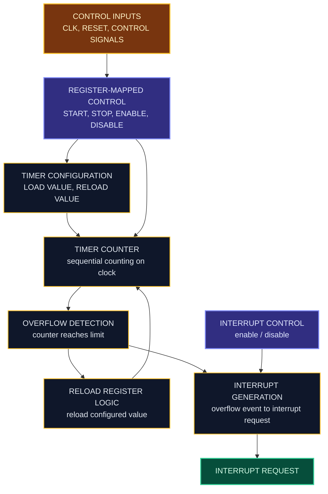
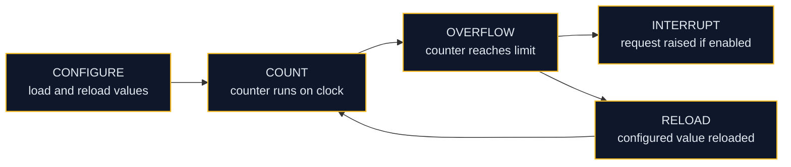
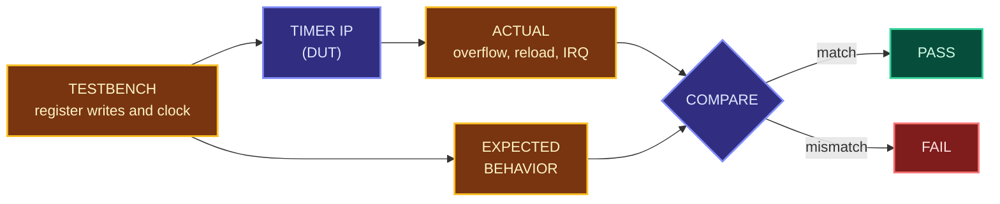
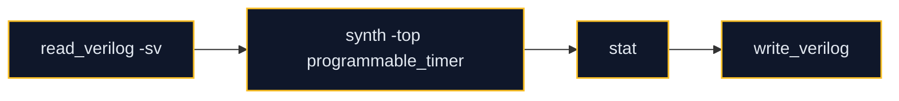

<div align="center">




<b>A synthesizable, register-mapped programmable timer with overflow detection, automatic reload and maskable interrupt generation, written in SystemVerilog.</b>

<br/>


<br/>

[Overview](#overview) |
[At a Glance](#project-at-a-glance) |
[Background](#background-timers-and-interrupts) |
[Functions](#supported-functions) |
[Architecture](#architecture) |
[Functional Description](#functional-description) |
[Interface](#interface) |
[Register Map](#register-map) |
[Operating Sequence](#operating-sequence) |
[Getting Started](#getting-started) |
[Verification](#verification) |
[Synthesis](#synthesis) |
[Applications](#applications) |
[FAQ](#faq) |
[License](#license)

</div>

---

## Overview

This project implements a **programmable timer with an integrated interrupt controller** in **SystemVerilog**.

The timer is configured through memory-mapped registers. Software (or a testbench) writes a load value and a reload value, then starts the timer. A counter advances on every clock cycle while the timer is running. When the counter reaches its limit, an **overflow event** is detected, the counter is **automatically reloaded** with the configured reload value, and, if interrupts are enabled, an **interrupt request** is raised on the output.

The design is **sequential**, written in a **synthesis-friendly** style, simulated at RTL level, inspected through waveform analysis and packaged as a reusable timer IP block.

<table>
<tr>
<td width="50%" valign="top">

#### Objectives
- Design a reusable programmable timer IP in SystemVerilog
- Control the timer through register-mapped start, stop, enable and disable
- Support configurable load and reload values
- Detect counter overflow and reload automatically
- Generate a maskable interrupt request on overflow
- Verify the full configure, count, overflow and interrupt sequence

</td>
<td width="50%" valign="top">

#### Key Features
- Programmable timer
- Sequential logic design
- Interrupt logic with enable and disable
- Register-mapped control
- Reload register for periodic operation
- Overflow detection
- SystemVerilog RTL
- Synthesizable design

</td>
</tr>
</table>

---

## Project at a Glance

| Attribute | Detail |
|:--|:--|
| **Design type** | Programmable Timer IP |
| **Description language** | SystemVerilog (RTL) |
| **Logic style** | Sequential, clocked |
| **Control method** | Register-mapped (start, stop, enable, disable) |
| **Configuration** | Load value and reload value |
| **Events** | Overflow detection |
| **Main output** | Interrupt request |
| **Functions** | 10 (timer control, configuration, overflow, interrupt) |
| **Simulation** | Verilator |
| **Waveform analysis** | GTKWave |
| **Synthesis** | Yosys |
| **License** | MIT |

---

## Background: Timers and Interrupts

A **timer** is a hardware counter driven by a clock. Because the clock frequency is known, counting a fixed number of cycles measures a fixed amount of time. Timers are used to create delays, generate periodic events, schedule tasks and measure intervals without keeping the processor busy.

An **interrupt** is a signal that tells the processor an event has happened and needs attention. Instead of polling the timer continuously, the processor waits for an interrupt request and then runs the matching service routine.

Almost every microcontroller and SoC contains programmable timers with interrupt support. Designing one covers the core skills of RTL design: register-mapped control, sequential logic, event detection, interrupt handling and verification.

---

## Supported Functions

| Group | Function | Description |
|:--|:--|:--|
| **Timer control** | `TIMER START` | Starts the counter running |
| **Timer control** | `TIMER STOP` | Stops the counter |
| **Timer control** | `TIMER ENABLE` | Enables the timer block |
| **Timer control** | `TIMER DISABLE` | Disables the timer block |
| **Configuration** | `TIMER LOAD` | Loads the configured load value into the counter |
| **Configuration** | `TIMER RELOAD` | Reloads the configured reload value after overflow |
| **Event** | `OVERFLOW DETECTION` | Detects when the counter reaches its limit |
| **Interrupt** | `INTERRUPT GENERATION` | Raises an interrupt request on an overflow event |
| **Interrupt** | `INTERRUPT ENABLE` | Allows overflow events to raise the interrupt request |
| **Interrupt** | `INTERRUPT DISABLE` | Masks the interrupt request |

---

## Architecture

The design is organized as a control input stage, register-mapped control, timer configuration, a counter, overflow detection, reload logic and an interrupt control and generation stage.

#### Block diagram

```text
              +--------------------+       +----------------------+
 CLK   ------>|   CONTROL INPUTS   |------>|  REGISTER-MAPPED     |
 RESET ------>|                    |       |  CONTROL             |
 CONTROL ---->|                    |       |  START STOP          |
 SIGNALS      +--------------------+       |  ENABLE DISABLE      |
                                           +----------+-----------+
                                                      |
                                           +----------v-----------+
                                           |  TIMER CONFIGURATION |
                                           |  LOAD VALUE          |
                                           |  RELOAD VALUE        |
                                           +----------+-----------+
                                                      |
                     +--------------------------------v------------------+
                     |                   TIMER COUNTER                    |
                     |            sequential counting on clock            |
                     +--------------------------------+------------------+
                                                      |
                                           +----------v-----------+
                                           |  OVERFLOW DETECTION  |
                                           +----+------------+----+
                                                |            |
                                  overflow      |            | overflow
                                                v            v
                              +-------------------+    +--------------------+
                              |  RELOAD REGISTER  |    |  INTERRUPT CONTROL |
                              |  LOGIC            |    |  enable / disable  |
                              +---------+---------+    +---------+----------+
                                        |                        |
                                        v                        v
                                 back to counter       +--------------------+
                                                       | INTERRUPT          |-----> IRQ
                                                       | GENERATION         |
                                                       +--------------------+
```

#### Data flow



#### Block breakdown

| # | Block | Role |
|:-:|:--|:--|
| `01` | **Control Inputs** | Accepts the clock, reset and control signals |
| `02` | **Register-Mapped Control** | Start, stop, enable and disable the timer through registers |
| `03` | **Timer Configuration** | Holds the load value and the reload value |
| `04` | **Timer Counter** | Counts sequentially on the clock |
| `05` | **Overflow Detection** | Flags an overflow event when the counter reaches its limit |
| `06` | **Reload Register Logic** | On overflow, reloads the configured timer value |
| `07` | **Interrupt Control** | Enables or disables interrupt generation |
| `08` | **Interrupt Generation** | Converts an overflow event into an interrupt request |
| `09` | **Functional Verification** | Testbench, RTL simulation and waveform analysis |
| `10` | **Final Block** | Verified timer IP that is reliable, synthesizable and reusable |

> **Final design block:** `CLK + RESET + CONTROL -> TIMER + INTERRUPT LOGIC -> INTERRUPT REQUEST`

---

## Functional Description

#### Control inputs
The clock drives all sequential logic. Reset returns the timer and interrupt logic to a known initial state. The control signals carry register reads and writes into the design.

#### Register-mapped control
Start, stop, enable and disable are controlled by writing to registers, the same way software controls a peripheral in a real SoC. Start and stop control whether the counter runs. Enable and disable control whether the timer block is active.

#### Timer configuration
Two values are programmed before the timer runs. The **load value** is placed into the counter when the timer is loaded. The **reload value** is placed into the counter after each overflow, which makes the timer periodic.

#### Timer counter
While the timer is running, the counter advances on each clock cycle. When the timer is stopped or disabled, the counter holds its value.

#### Overflow detection
When the counter reaches its limit, the overflow detector raises an overflow event for one step of the design.

#### Reload register logic
On an overflow event, the counter is loaded with the configured reload value, so the timer keeps running and produces a repeating event without any software intervention.

#### Interrupt control
The interrupt enable and disable bits act as a mask. With interrupts enabled, an overflow event passes through to the interrupt request. With interrupts disabled, the overflow event is ignored at the output.

#### Interrupt generation
Converts an overflow event into an interrupt request, which is the main output of the design.

---

## Interface

#### Ports

| Port | Direction | Description |
|:--|:-:|:--|
| Clock | Input | System clock for all sequential logic |
| Reset | Input | Resets the timer and interrupt logic to the initial state |
| Control signals | Input | Register-mapped interface used to program and control the timer |
| Interrupt request | Output | Raised when an overflow event occurs and interrupts are enabled |

Exact port names, widths and reset polarity are defined in `rtl/programmable_timer.sv`.

#### Control commands

| Command | Effect |
|:--|:--|
| `START` | Counter begins running |
| `STOP` | Counter stops running |
| `ENABLE` | Timer block becomes active |
| `DISABLE` | Timer block becomes inactive |
| `INTERRUPT ENABLE` | Overflow events can raise the interrupt request |
| `INTERRUPT DISABLE` | Interrupt request is masked |

---

## Register Map

| Register | Purpose | Offset | Bit fields |
|:--|:--|:-:|:-:|
| Control | Start, stop, enable and disable the timer | `TBD` | `TBD` |
| Load value | Value placed into the counter on load | `TBD` | `TBD` |
| Reload value | Value placed into the counter after overflow | `TBD` | `TBD` |
| Interrupt control | Interrupt enable and disable | `TBD` | `TBD` |

---

## Operating Sequence

The timer follows the same five steps every time: configure, count, overflow, interrupt and verify.



1. **Configure.** Program the load value and the reload value, then set the interrupt enable bit as required.
2. **Start.** Enable the timer and start it. The counter begins to advance on each clock cycle.
3. **Overflow.** The counter reaches its limit and an overflow event is detected.
4. **Interrupt and reload.** The configured reload value is placed back into the counter, and the interrupt request is raised if interrupts are enabled.
5. **Repeat or stop.** The timer keeps repeating steps 3 and 4 until it is stopped or disabled.

---

## Repository Structure

```text
programmable-timer-and-interrupt-controller/
├── rtl/
│   └── programmable_timer.sv       # Timer, overflow, reload and interrupt logic
├── tb/
│   └── programmable_timer_tb.sv    # Self-checking testbench
├── sim/
│   └── waves.vcd                   # Generated waveform dump
├── synth/
│   ├── synth.ys                    # Yosys synthesis script
│   ├── programmable_timer_netlist.v # Gate-level netlist
│   └── synth_report.txt            # Yosys stat report
├── LICENSE
└── README.md
```

---

## Technology Stack

| Tool | Role in this project |
|:--|:--|
|  | RTL design and testbench |
|  | Compiles and simulates the design |
|  | Views the simulation waveforms |
|  | Synthesizes the RTL to a gate-level netlist |

---

## Getting Started

#### Prerequisites

| Tool | Purpose | Version |
|:--|:--|:--|
| Verilator | RTL simulation | 5.x or later |
| GTKWave | Waveform viewer | Any recent |
| Yosys | RTL synthesis | Any recent |

```bash
# Ubuntu / Debian
sudo apt update
sudo apt install verilator gtkwave yosys
```

#### 1. Clone

```bash
git clone https://github.com/dhruvalmistry2007/programmable-timer-and-interrupt-controller.git
cd programmable-timer-and-interrupt-controller
```

#### 2. Simulate

```bash
verilator --binary --trace -Wall --top-module programmable_timer_tb rtl/programmable_timer.sv tb/programmable_timer_tb.sv
./obj_dir/Vprogrammable_timer_tb
```

#### 3. View waveforms

```bash
gtkwave sim/waves.vcd
```

#### 4. Synthesize

```bash
yosys -p "read_verilog -sv rtl/programmable_timer.sv; synth -top programmable_timer; stat; write_verilog synth/programmable_timer_netlist.v"
```

---

## Verification

The testbench configures the timer through its register interface, lets it count, and checks overflow, reload and interrupt behavior. Results are then inspected as waveforms.



#### Test plan

| Area | Scenario | Expected behavior |
|:--|:--|:--|
| Reset | Apply reset | Counter, flags and interrupt request return to the initial state |
| Configuration | Write load and reload values | Values are stored and used by the counter |
| Load | Load the counter | Counter takes the configured load value |
| Start | Start the timer | Counter begins advancing on each clock |
| Stop | Stop a running timer | Counter holds its value |
| Enable and disable | Disable a running timer | Counting halts and no overflow occurs |
| Overflow | Run until the limit | Overflow event is detected |
| Reload | Overflow occurs | Counter takes the configured reload value |
| Periodic operation | Run through several overflows | Overflow repeats at a steady interval |
| Interrupt enabled | Overflow with interrupt enabled | Interrupt request is raised |
| Interrupt disabled | Overflow with interrupt disabled | Interrupt request stays low |
| Interrupt toggle | Enable and disable during operation | Request follows the enable setting |

#### Coverage matrix

| Area | Functions checked | Result |
|:--|:--|:-:|
| Timer control | Start, stop, enable, disable | `TBD` |
| Configuration | Load, reload | `TBD` |
| Overflow | Detection and reload | `TBD` |
| Interrupt | Generation, enable, disable | `TBD` |

#### Waveform analysis checklist

| Signal | What to confirm |
|:--|:--|
| Clock and reset | Reset clears state, then the clock drives counting |
| Control writes | Start, stop, enable and disable take effect as written |
| Counter | Advances while running, holds when stopped, reloads on overflow |
| Overflow event | Appears when the counter reaches its limit |
| Interrupt request | Follows overflow only while interrupts are enabled |

---

## Synthesis

The RTL is synthesized with **Yosys** to confirm that the design is synthesizable. The flow reads the SystemVerilog source, elaborates the design, maps it to generic logic cells, prints a cell statistics report and writes the gate-level netlist. The netlist and the report are stored in [`synth/`](synth/).



| Step | Command | Purpose |
|:--|:--|:--|
| Read | `read_verilog -sv` | Loads the SystemVerilog RTL |
| Synthesize | `synth -top programmable_timer` | Elaborates and maps the design to generic gates |
| Report | `stat` | Prints cell and wire statistics |
| Export | `write_verilog` | Writes the gate-level netlist |

#### Results

| Metric | Value |
|:--|:-:|
| Top module | `programmable_timer` |
| Total cells | `TBD` |
| Flip-flops | `TBD` |
| Wires / wire bits | `TBD` |
| Logic depth / critical path | `TBD` |
| Area | `TBD` |

---

## Design Considerations

| Aspect | Approach |
|:--|:--|
| **Logic style** | Sequential design with clocked registers and a counter |
| **Control** | Register-mapped, so the timer behaves like a real SoC peripheral |
| **Periodic operation** | Reload register restarts the count automatically on overflow |
| **Interrupt handling** | Overflow event is gated by an interrupt enable before reaching the output |
| **Synthesis** | Synthesizable RTL structure, targeting a Yosys flow |
| **Verification** | Simulation-based, with directed tests and waveform inspection |

#### Current limitations
- Single timer channel
- No prescaler, so the count rate equals the clock rate
- Verified through simulation only, with no formal verification

---

## Applications

- Periodic tick generation for operating systems and schedulers
- Delay generation and time-out detection
- Interval measurement in embedded systems
- Interrupt-driven task triggering in microcontrollers and SoCs
- Reusable timer peripheral in ASIC and FPGA designs
- Teaching and reference design for sequential RTL and interrupt logic

---

## Customization

#### Change the timing period

The time between interrupts depends on the reload value and the clock frequency. Program a different reload value through its register to change the period.

#### Add a new control function

1. Add a new bit or register to the register-mapped control block.
2. Implement the new behavior in the matching block of the timer.
3. Update the register map table in this README.
4. Add test scenarios for it in the testbench and re-run the simulation.

---

## Troubleshooting

| Problem | Likely cause | Fix |
|:--|:--|:--|
| `--binary` option not recognized | Verilator version is older than 5.x | Upgrade Verilator to 5.x or later |
| `waves.vcd` is not generated | Tracing is not enabled | Build with `--trace` and make sure the testbench calls `$dumpfile` and `$dumpvars` |
| Counter never changes | Timer is not enabled or not started | Write enable and start before expecting the counter to advance |
| No interrupt request | Interrupts are disabled | Set the interrupt enable bit before the overflow |
| Interrupt request fires only once | Reload value or enable state is wrong | Check the reload value and that the timer stays enabled |
| Yosys cannot find the top module | `-top` name does not match the module name | Use the exact module name from `rtl/programmable_timer.sv` |

---

## FAQ

**Why is the design register-mapped?**
Real peripherals are controlled by software through registers. A register-mapped interface keeps this timer reusable in a bus-based SoC.

**What does the reload register do?**
After each overflow the counter is reloaded with the configured value, so the timer produces a repeating event on its own.

**Can the interrupt be turned off?**
Yes. With interrupts disabled, overflow events still happen but the interrupt request stays low.

**Why Verilator, GTKWave and Yosys?**
They are free, open-source tools that cover simulation, waveform viewing and synthesis, so the whole project can be reproduced without licenses.

---

## Learning Outcomes

- Designing a register-mapped peripheral in SystemVerilog
- Writing sequential, synthesizable RTL with a counter and reload logic
- Detecting events and generating maskable interrupt requests
- Building a testbench that drives a register interface
- Debugging timing behavior through waveform analysis
- Running RTL synthesis and reading the resulting reports

---

## Design Flow


<div align="center">

`CONFIGURE` | `COUNT` | `OVERFLOW` | `INTERRUPT` | `VERIFY`

</div>

---

## Future Work

- Add a prescaler for slower count rates
- Add multiple timer channels
- Add one-shot and periodic mode selection
- Add a standard bus wrapper such as APB or AXI-Lite
- Add self-checking randomized tests
- Run the design through an RTL-to-GDSII flow (OpenLane)

---

## Contributing

Suggestions and improvements are welcome. Open an issue to discuss a change, or submit a pull request with a clear description of what it does and the simulation results that support it.

---

## References

- [Verilator](https://www.veripool.org/verilator/): open-source SystemVerilog simulator
- [GTKWave](https://gtkwave.sourceforge.net/): waveform viewer
- [Yosys Open SYnthesis Suite](https://yosyshq.net/yosys/): open-source RTL synthesis framework
- IEEE Std 1800: SystemVerilog language standard

---

## License

This project is licensed under the **MIT License**. See the [LICENSE](LICENSE) file for details.

---

## Author

<div align="center">

**Dhruval Mistry**

[](https://github.com/dhruvalmistry2007)

<br/>


</div>


